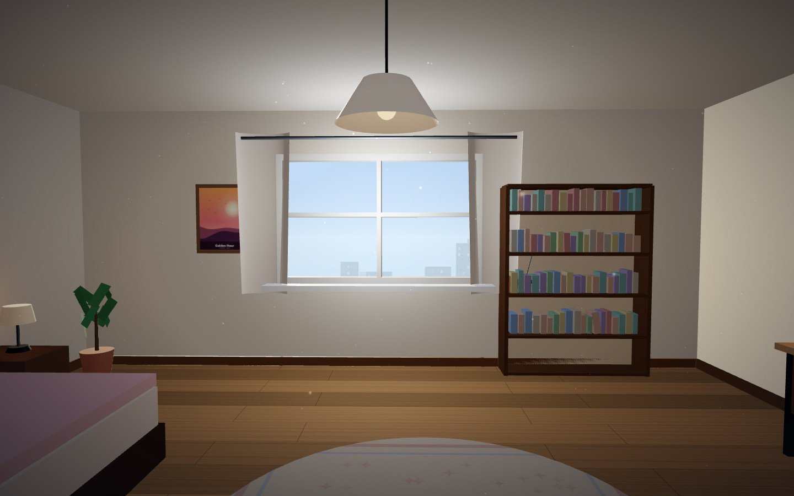
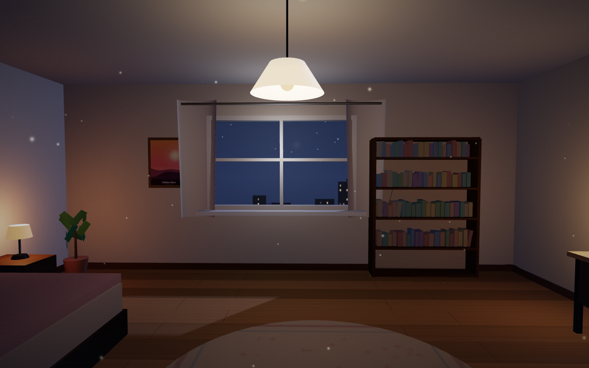

# 🏠 我的动漫小屋 · Anime Bedroom

用 **Vue 3 + Vite + Three.js** 做的一间可以第一人称走进去的动漫风卧室。
模型可以在 Blender 里随便搭，代码负责灯光、漫游、点击交互和昼夜氛围。

> 现在仓库里没有 GLB 也能直接跑：场景由代码程序化生成（`src/three/RoomBuilder.js`），
> 你把 `public/models/bedroom.glb` 放进来，它就会自动切换成你的模型。




---

## 快速开始

```bash
npm install
npm run dev      # → http://localhost:5173
```

打开页面 → 点「开始漫游」→ 鼠标锁定后即可用 **WASD** 走路。

> ⚠️ 一定要用 `npm run dev`（Vite 服务器），**不要直接双击 index.html**，
> 否则 GLB 和贴图会因为跨域加载失败。

```bash
npm run build    # 产物在 dist/
npm run preview  # 本地预览构建结果
```

---

## 功能对照

### 第一阶段 · 跑通 Demo
| 功能 | 位置 |
| --- | --- |
| Scene / PerspectiveCamera / WebGLRenderer + 阴影 | `src/three/BedroomApp.js` |
| 三层光照（环境光 + 半球光 + 平行光 + 点光源） | `src/three/Lighting.js` |
| 第一人称漫游 PointerLockControls | `src/three/Player.js` |
| 碰撞（AABB 分轴推出，不穿墙不穿家具） | `Player.js → isBlocked()` |
| GLB 加载 + 进度 + 失败兜底 | `BedroomApp.js → _loadRoom()` |
| 加载页 / 开始漫游 UI | `components/LoadingScreen.vue`、`PauseOverlay.vue` |

### 第二阶段 · 氛围
| 功能 | 位置 |
| --- | --- |
| Raycaster 点击摆件 | `src/three/interactions.js` |
| 相框 → 放大看图 | `components/PhotoModal.vue` |
| 电脑 → 新标签打开链接 | `BedroomApp.js → _handlePick()` |
| 留言簿 → 弹窗写留言 | `components/GuestbookModal.vue` |
| 昼夜切换（白天 / 黄昏 / 夜晚，含天空渐变） | `Lighting.js → setPreset()` + `constants.js → TIME_PRESETS` |
| 背景音乐（有 mp3 用 mp3，没有就 WebAudio 现场合成 lofi） | `src/audio/LofiPlayer.js` |
| 粒子：夜晚萤火虫 + 白天浮尘 | `src/three/particles.js` |
| 自动巡游镜头（Tween） | `src/three/tour.js` |
| Stats 帧率 + lil-gui 调参 | `BedroomApp.js → _initDebug()` |

### 第三阶段 · 社交
| 功能 | 位置 |
| --- | --- |
| 进门自动打卡 | `App.vue → runCheckIn()` |
| 留言板（Cloudflare KV） | `functions/api/messages.js` |
| 打卡接口 | `functions/api/checkin.js` |
| 本地降级（没后端时存 localStorage） | `src/services/api.js` |
| 门 → Portal 占位 | `PICK_door` 物体 |

---

## 操作

| 键 | 作用 |
| --- | --- |
| W A S D | 前后左右 |
| Shift | 奔跑 |
| 鼠标 | 转视角 |
| ESC | 释放鼠标 / 暂停 |
| 左键 | 点击准星指向的摆件 |
| 1 / 2 / 3 | 白天 / 黄昏 / 夜晚 |
| T | 自动巡游 |
| M | 背景音乐 |
| L | 台灯开关 |

右上角 **⚙ 参数面板**（lil-gui）可以实时调灯光强度、太阳位置、曝光、FOV，还能显示碰撞盒。

---

## 目录结构

```text
.
├─ public/
│  ├─ models/bedroom.glb       ← 你的 Blender 导出的模型放这里
│  ├─ images/                  ← 照片、插画
│  ├─ audio/bgm.mp3            ← 可选背景音乐
│  └─ draco/                   ← Draco 解码器（构建时自动准备）
├─ src/
│  ├─ App.vue                  ← 所有 UI 的编排
│  ├─ components/              ← 加载页 / HUD / 弹窗 / 提示
│  ├─ audio/LofiPlayer.js      ← BGM（mp3 或 WebAudio 合成）
│  ├─ services/api.js          ← 留言 / 打卡（后端 or localStorage）
│  └─ three/
│     ├─ BedroomApp.js         ← 主控：渲染循环、加载、拾取分发
│     ├─ constants.js          ← 房间尺寸 + 三档时间预设（改这里调色）
│     ├─ RoomBuilder.js        ← 程序化卧室（也是 Blender 布局参考）
│     ├─ Lighting.js           ← 灯光 + 天空球 + 昼夜 Tween
│     ├─ Player.js             ← 第一人称 + 碰撞
│     ├─ interactions.js       ← Raycaster 拾取
│     ├─ particles.js          ← 萤火虫 / 浮尘
│     ├─ tour.js               ← 自动巡游
│     └─ textures.js           ← 全部程序化贴图（木地板/墙/海报/屏幕）
├─ functions/api/              ← Cloudflare Pages Functions
└─ docs/
   ├─ blender-guide.md         ← 建模与导出规范（必读）
   └─ deploy.md                ← 部署到个人网页 + KV
```

---

## 换成你自己的房间

1. 用 Blender 搭房间，按 [docs/blender-guide.md](docs/blender-guide.md) 的规范命名和导出。
2. 把生成的 `bedroom.glb` 丢进 `public/models/`。
3. 刷新页面 —— 检测到文件就会自动替换掉程序化房间。

交互物体靠**名字前缀**识别，不需要写代码：

| 命名 | 点击效果 |
| --- | --- |
| PICK_photo_1 | 弹窗放大图（可在 Blender 自定义属性里写 title / caption / image） |
| PICK_pc | 新标签打开链接（自定义属性 url） |
| PICK_book | 打开留言簿 |
| PICK_radio | 播放 / 暂停 BGM |
| PICK_door | Portal 占位弹窗 |
| PICK_lamp | 台灯开关 |
| COL_xxx | 碰撞盒（任意立方体，运行时自动隐藏） |

Blender 里的「自定义属性」会原样进入 GLB 的 `userData`，代码会读取。

---

## 改配色 / 改光照

打开 `src/three/constants.js` 的 `TIME_PRESETS`，三档时间全是纯数据：

```js
night: {
  ambient: { color: '#7d8fd6', intensity: 0.24 },
  sun:     { color: '#9fb8ff', intensity: 0.55, position: [5, 8, -6] },
  ceilingLamp: 1.35,
  skyTop: '#050816', skyHorizon: '#1b2a55', stars: 1.0,
}
```

调完刷新就能看到，Tween 会自动平滑过渡。

---

## 接上真正的留言后端

默认没有后端 → 留言存 localStorage（留言簿里会显示「本地模式」）。
部署到 Cloudflare Pages 并绑定 KV 后自动变「在线」，见 [docs/deploy.md](docs/deploy.md)。

Supabase 方案也在同一篇文档里。

---

## 性能与避坑

- 模型面数控制在 **10 万面以内**，导出时勾选 **Draco 压缩**。
- 阴影只给地面、墙、主要家具；本项目的 GLB 处理会按体积自动跳过小物件的投影。
- 贴图 1024 / 2048 就够，转成 webp。
- 手机端 PointerLock 支持很差，本项目默认提示用桌面浏览器。
- 模型发黑 90% 是灯光问题：本项目已备好环境光兜底。

---

## 技术栈

Vue 3 · Vite · Three.js · @tweenjs/tween.js · lil-gui · stats.js · Cloudflare Pages Functions
